# QA 테스트 보고서

- 실행일: 2026-11-11 · 빌드: `vite build` 프로덕션 번들 (JS 880 kB / gzip 246 kB, 외부 에셋 0)
- 환경: Linux 컨테이너(4 vCPU, GPU 없음), Headless Chromium + **SwiftShader(소프트웨어 렌더러)**, 1280×720
- 방법: `npm test`(단위), `npm run test:e2e`(프로덕션 빌드를 실제 브라우저에서 구동)
- **사람이 직접 플레이한 테스트는 수행하지 못했습니다.** 아래 결과는 전부 자동화 테스트이며, 조작감·난이도·재미는 검증 범위 밖입니다.

## 1. 요약

| 구분 | 결과 |
|---|---|
| 단위 테스트(DPS 밸런스 모델) | **9 / 9 통과** |
| E2E 체크 | **63 / 63 통과** (소요 1,176 s) |
| 캠페인 완주 | 미션 01–05 전부 결과 화면까지 도달 |
| 콘솔/페이지 에러 | 0건 |
| JS 힙 | 23 MB (전체 런 종료 시점) |
| Electron 래퍼 | Linux(Xvfb)에서 메인 메뉴까지 부팅 확인 |
| Windows 패키지 | `SpecialSoldier.exe` 생성됨 — **Windows에서 실행 검증은 못 함** |

## 2. E2E 체크 항목 (63)

| 영역 | 항목 | 결과 |
|---|---|---|
| 부트/메뉴 | 부팅, 메인 메뉴 7개 버튼 각각 해당 화면 열림(CAMPAIGN·MULTIPLAYER·OPERATIONS·WEAPONS·OPERATOR·SETTINGS·EXIT) | 8/8 |
| 설정 | 품질 프리셋 적용(섀도 on/off), FOV 슬라이더, localStorage 저장 | 3/3 |
| 무기고/캠페인 | 잠긴 무기 장착 불가, DPS 패널 수치, 신규 프로필에서 미션 2–5 잠금 | 3/3 |
| 시네마틱 | DEPLOY → 보트 시네마틱 → 1인칭 상륙 전환 | 2/2 |
| 이동 | 걷기(1.5 s에 6.1 m), 달리기+스태미나 소모, 슬라이딩, 엎드리기, 일어서기, 점프 | 6/6 |
| 무기 | 무기 교체 2종, 자동 사격, 반동 상승, 사격 모드 전환, 단발, 재장전 시작/완료, ADS(줌+탄퍼짐 감소), 수류탄 투척/폭발 | 11/11 |
| 장비/UI | 야간투시경, 전술 라이트, 열화상 잠금, 전술 지도, 일시정지/재개 | 6/6 |
| 적 AI | 시야각 밖에서 미발견, 시야 내 인지 게이지→교전, 분대 경보 전파, 5초 생존 시 증원 호출, 엄폐 사용 | 5/5 |
| 피해/사망 | 피격(방어구 우선 흡수), 사망→KIA 화면, 체크포인트 재시작 | 3/3 |
| 스텔스 | 소음 권총 헤드샷 처치 후 경보 없음 | 1/1 |
| 캠페인 | 미션 5개 완료 + 미션별 해금, 엔딩 화면 | 11/11 |
| 해금 장비 | 열화상, 드론 자유 비행, 드론 적 태그 | 3/3 |
| 안정성 | 전체 런 동안 콘솔/페이지 에러 없음 | 1/1 |

### 캠페인 자동 플레이 결과

| 미션 | 등급 | 처치 | 명중률 | 게임 내 시간 | 경보 |
|---|---|---|---|---|---|
| 01 SILENT LANDING | A | 9 | 76% | 11 s | 0 |
| 02 DEEP JUNGLE | A | 13 | 63% | 38 s | 1 |
| 03 BLACK COBRA BASE | A | 5 | 97% | 20 s | 1 |
| 04 UNDERGROUND ZERO | A | 16 | 80% | 73 s | 1 |
| 05 LAST EXTRACTION | A | 17 | 65% | 79 s | 0 |

> **해석 주의:** 이 플레이는 에임봇 + 목표 지점 순간이동 + 무적 모드를 쓰는 스크립트입니다.
> "모든 목표·스크립트 이벤트·컷신·결과 화면이 끊기지 않고 이어진다"는 것만 증명하며, 실제 플레이 시간·난이도·등급을 대표하지 않습니다.

## 3. 성능 (측정값 그대로)

미션 03 기지 남문 시야, 5초간 `requestAnimationFrame` 실측.

| 품질 | 해상도 | FPS | 최악 프레임 | 드로콜 | 삼각형 |
|---|---|---|---|---|---|
| Low | 960×540 | **1.8** | 1,383 ms | 413 | 463 k |
| Medium | 1280×720 | **1.8** | 1,033 ms | 531 | 710 k |
| High | 1280×720 | **1.2** | 917 ms | 531 | 710 k |

- 이 수치는 **GPU가 없는 CPU 소프트웨어 렌더러(SwiftShader)** 결과입니다. 실제 GPU 성능을 말해주지 않습니다.
- **실제 GPU에서의 프레임은 측정하지 못했습니다.** 따라서 "PC 60 FPS / 120 FPS" 목표는 **달성 여부 미검증**입니다.
- 게임 로직(렌더 제외)은 프로파일링에서 틱당 수 ms 이하였습니다(전투 중 최대 30 ms 미만).
- GPU에서 확인이 필요한 항목: 드로콜 400–600(병사 1명당 메시 ~16개 — 캐릭터 메시 머지/인스턴싱 여지), 포인트 라이트 ~20개의 포워드 셰이딩 비용, 섀도맵 2048².

## 4. 테스트 중 발견해 수정한 결함

| # | 증상 | 원인 | 조치 |
|---|---|---|---|
| 1 | 플레이어 탄환이 적을 통과(434발 0명중) | 공기저항 적용 후 방향 벡터를 다시 정규화하지 않아 구 판정 실패 | 속도 계산 순서 수정 |
| 2 | 사격 방향이 1프레임 늦음 | 카메라 월드 행렬이 렌더 때만 갱신 | 카메라 갱신 직후 행렬 업데이트 |
| 3 | 아군 AI 크래시 | 표적 재탐색 후 null 참조 | 가드 추가 |
| 4 | 기지 경보음에서 예외 | 위치에 y값 없음 → AudioParam NaN | 오디오 위치 유효성 검사 |
| 5 | 상륙 지점이 수심 3 m | 해안선 좌표 오산 | 상륙/보트/해안 순찰 좌표 재배치 |
| 6 | 설정을 바꿀 때마다 전체 셰이더 재컴파일 | `needsUpdate` 무조건 호출 | 섀도 토글 시에만 재컴파일 |
| 7 | 첫 수류탄/첫 적 등장 시 멈칫 | 최초 사용 시 셰이더 컴파일 | 부트 시 셰이더 워밍업 |
| 8 | 감시탑 저격수를 아래에서 맞힐 수 없음 | 난간이 몸통을 완전히 가림 | 난간 높이 1.0 → 0.7 m |
| 9 | 아군이 적을 거의 다 처치 | 아군 화력 과다 | 피해·정확도·사거리 하향 |
| 10 | 샷건/DMR의 실전 DPS가 비현실적 | 명중 모델이 게임의 탄퍼짐 방식과 불일치, 조준 시에도 지향 블룸 누적 | 모델을 게임 로직과 일치시키고 블룸을 조준 탄퍼짐 기준으로 변경 |
| 11 | 지하 시설이 거의 암흑 | 조명 강도 부족 | 환경광·포인트 라이트 상향 |

수정 10·11 이후 프로덕션 빌드를 다시 만들었고, 재빌드 후 회귀 실행 결과는 §6에 적었습니다.

## 5. 알려진 문제 / 한계

- **실기 미검증**: 실제 GPU·실제 마우스/키보드·포인터 락·오디오 출력(스피커)은 자동 테스트로 확인하지 못했습니다. 헤드리스에서는 WebAudio가 재생 상태가 아니어서 소리 자체는 들어보지 못했습니다.
- **내비메시 없음**: 적·아군은 조향 + 벽 슬라이딩으로 이동합니다. 건물 내부나 지하 시설 모서리에서 끼일 수 있고(재계획으로 완화), 문을 찾아 돌아가는 경로 탐색은 못 합니다.
- **1인칭 총기 클리핑**: 벽에 붙으면 총이 벽을 뚫고 보입니다(별도 뷰모델 패스 없음).
- **체크포인트**: 죽으면 마지막 목표 완료 지점에서 재시작하며 적 피해는 유지됩니다. 세이브 슬롯/미션 중 저장은 없습니다.
- **난이도 밸런스**: 수치는 설계값이며 사람 플레이로 튜닝하지 않았습니다.
- **열화상**: 실제 열 시뮬레이션이 아니라 적 머티리얼을 밝게 바꾸는 방식입니다.
- **수중**: 수영 없음. 수심 1.45 m 이상은 진입 불가(보이지 않는 경계).
- **음성**: 무전 음성은 브라우저 음성합성이라 OS/브라우저에 따라 없거나 품질이 다릅니다.
- **시네마틱 직후** 레터박스가 0.4초 페이드되는 동안 HUD와 겹쳐 보입니다.
- **미구현**: 멀티플레이어, 배경 음악, 키 리바인딩, 게임패드, DLSS/FSR, 차량 탑승.

## 6. 재빌드 후 회귀

수정 10·11을 반영해 다시 만든 최종 프로덕션 빌드(Windows 패키지에 들어간 것과 동일한 `dist/`)로 캠페인 구간을 재실행했습니다.

- **16 / 16 통과** (785 s): 부팅, 미션 01–05 완주 + 해금, 엔딩 화면, 열화상, 드론 비행/태그, 콘솔 에러 0건
- 미션별: M01 9킬·94% / M02 13킬·78% / M03 5킬·81% / M04 15킬·95% / M05 15킬·70% (전부 스크립트 플레이)
- 성능(SwiftShader): Low 3.0 FPS, Medium 1.3 FPS, High 1.6 FPS — 실행마다 편차가 크며 §3과 같은 한계가 적용됩니다.
- 이 재실행은 메뉴·조작·AI 단위 체크(§2의 앞 47개)를 다시 돌리지 않았습니다. 그 항목들은 재빌드 직전 빌드에서 통과한 결과입니다.

## 6-b. Blender 에셋 빌드(v0.2) 재검증

Blender 5.3 모델 22종을 넣은 빌드로 전체 E2E를 다시 실행했습니다.

- **63 / 63 통과** (1,474 s), 캠페인 미션 01–05 완주, 콘솔 에러 0건, JS 힙 69 MB
- 성능(SwiftShader, 미션 03): Low 1.4 FPS · Medium 1.8 FPS · High 1.4 FPS — 드로콜 363(이전 531), 삼각형 174만(이전 71만). 실제 GPU 수치는 여전히 미측정.
- 이 실행 이후 추가한 실사화 개선(베이크 AO, 환경광, 디테일 노멀, 반사 수면, 블룸 조정)이 들어간 **최종 빌드**는 캠페인 구간 회귀만 다시 돌렸습니다 → 결과: **16 / 16 통과** (1,368 s) — 미션 01–05 완주, 엔딩, 열화상, 드론, 콘솔 에러 0건, JS 힙 73 MB. 성능(SwiftShader): Low 1.4 · Medium 0.7 · High 1.7 FPS(편차 큼).
- 그 뒤 추가한 인트로 영상 연결부(`public/video/mN-intro.*`)가 들어간 빌드도 캠페인 구간을 다시 실행했습니다 → **16 / 16 통과** (1376 s), 미션 01–05 완주. 영상 재생 자체는 합성 .webm 클립으로만 확인했고 실제 Flow 영상(.mp4)으로는 테스트하지 못했습니다.
- 표면 텍스처(위장·때) 빌드: 캠페인 구간 16 / 16 통과 (1,406 s).
- **v0.3 빌드**(F2 튜닝 패널, 탭 숨김 일시정지, 단일 파일 빌드 포함): 캠페인 구간 **16 / 16 통과** (1495 s), 미션 01–05 완주, 콘솔 에러 0건. 튜닝 패널은 슬라이더로 연사 속도를 바꿔 DPS 표시가 갱신되는 것을, 단일 파일 빌드는 `file://` 에서 메뉴까지 부팅되는 것을 따로 확인했습니다.
- **v0.4 빌드**(트럭·감시탑·통신탑·레이더·가로등·벽/지붕 패널을 Blender 모델로 교체): 캠페인 구간 **16 / 16 통과** (1,670 s), 미션 01–05 완주(미션 02의 통신탑 폭파 연출 포함), 콘솔 에러 0건, JS 힙 111 MB. 성능(SwiftShader): Low 1.2 · Medium 0.6 · High 1.2 FPS, 드로콜 426, 삼각형 217만 — 삼각형 수가 계속 늘고 있어 실제 GPU 확인이 더 중요해졌습니다. 회귀 뒤 바뀐 것은 메뉴의 버전 표기 한 줄뿐입니다.
- GTAO(화면 공간 AO) 옵션은 자동 테스트에서 켜 보지 않았습니다(기본 꺼짐, 실험 옵션).

## 7. Windows 빌드

- `npm run build:win` → `release/SpecialSoldier-win32-x64/SpecialSoldier.exe` (Electron 33, x64, 폴더 269 MB / zip 115 MB)
- 확인한 것: PE32+ x86-64 실행 파일 생성, `resources/app` 에 `dist/`·`electron/main.cjs`·`package.json` 포함, 동일 래퍼가 Linux(Xvfb)에서 메인 메뉴 상태까지 부팅.
- **확인하지 못한 것: Windows에서의 실제 실행.** 이 환경에는 Windows도 Wine도 없습니다. 코드 서명·설치 프로그램·아이콘도 없습니다.
- 바이너리는 용량 때문에 저장소에 커밋하지 않았습니다(`release/` 는 .gitignore).

## 8. 스크린샷 (자동 테스트 캡처, 소프트웨어 렌더러)

| | |
|---|---|
| 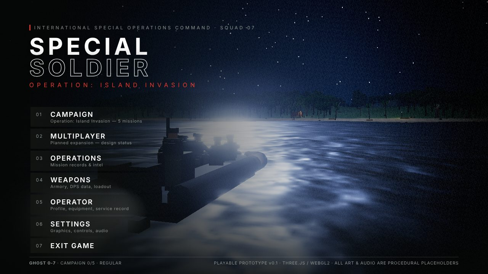 메인 메뉴 | 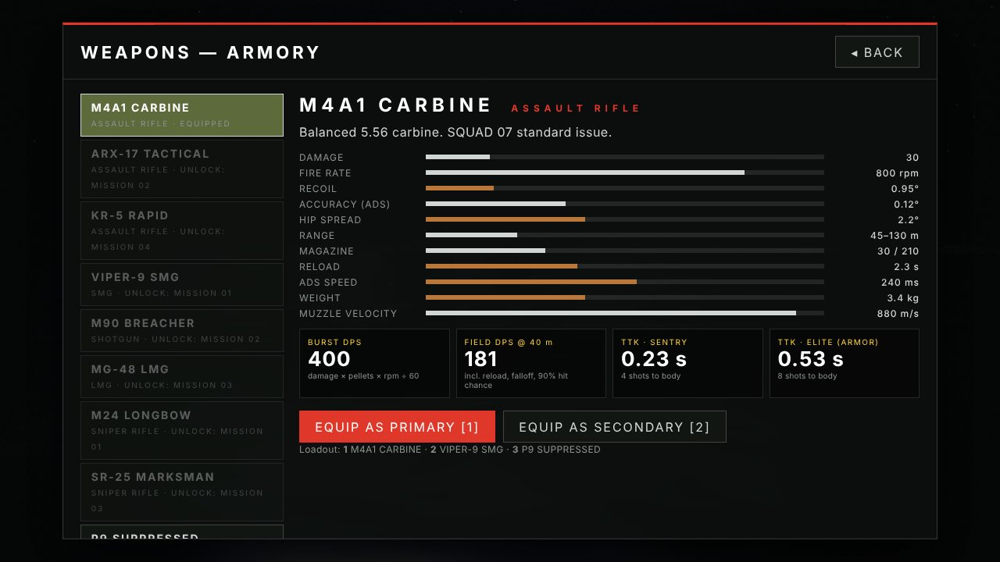 무기고 / DPS |
| 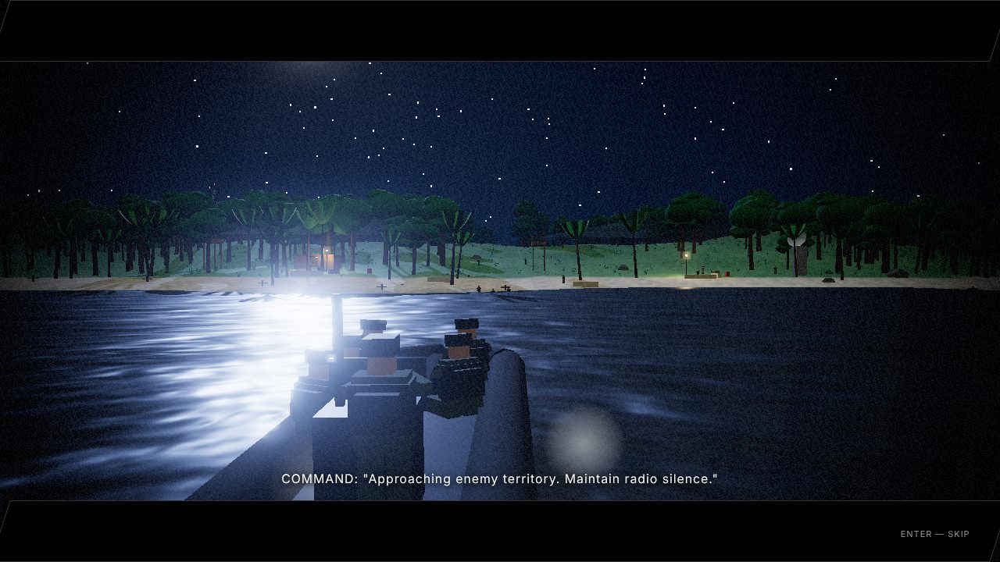 보트 침투 시네마틱 | 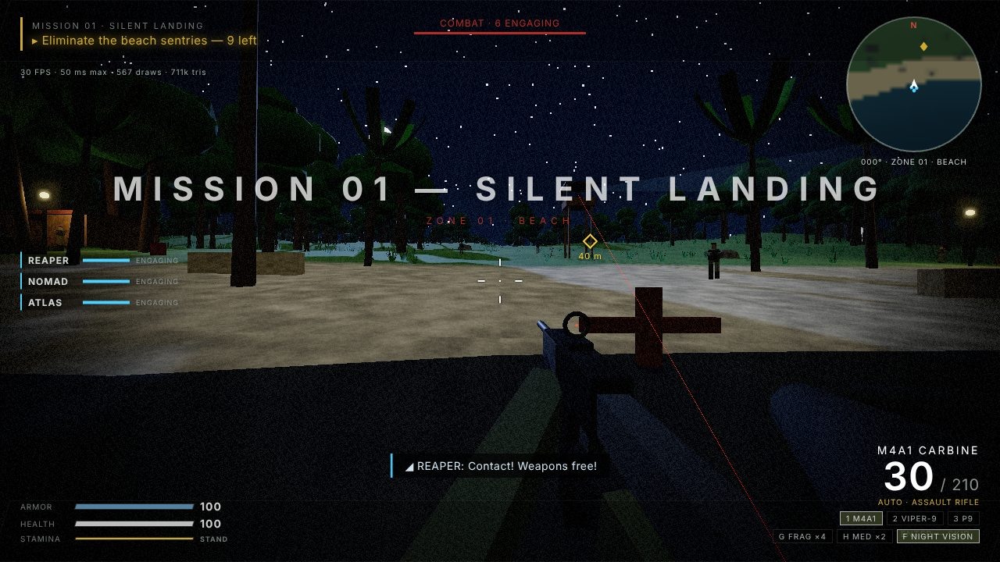 해안 상륙 |
| 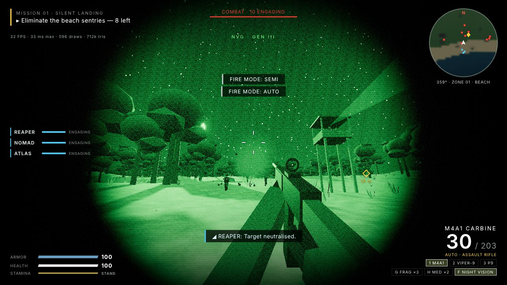 야간투시경 | 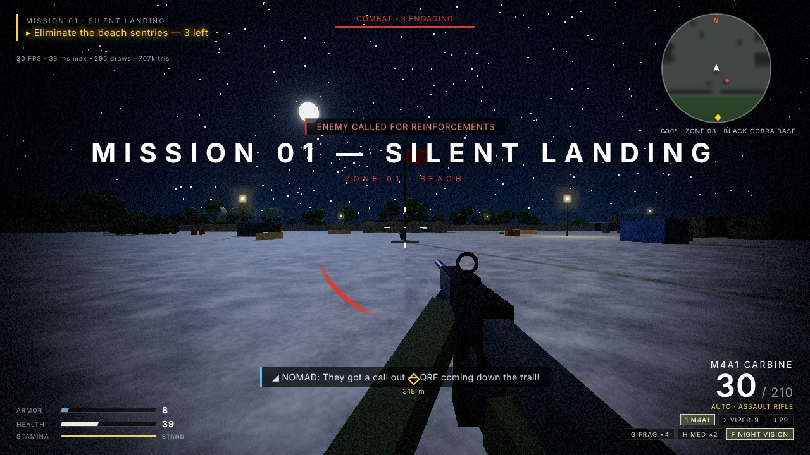 해변 교전 |
| 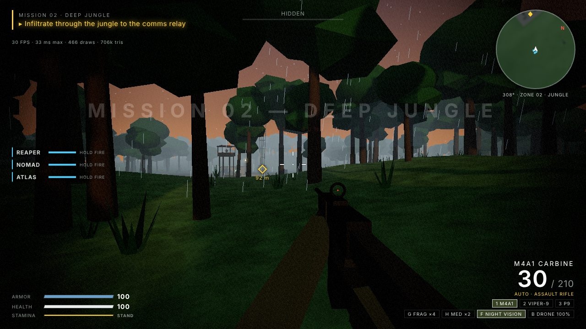 정글(새벽·비) | 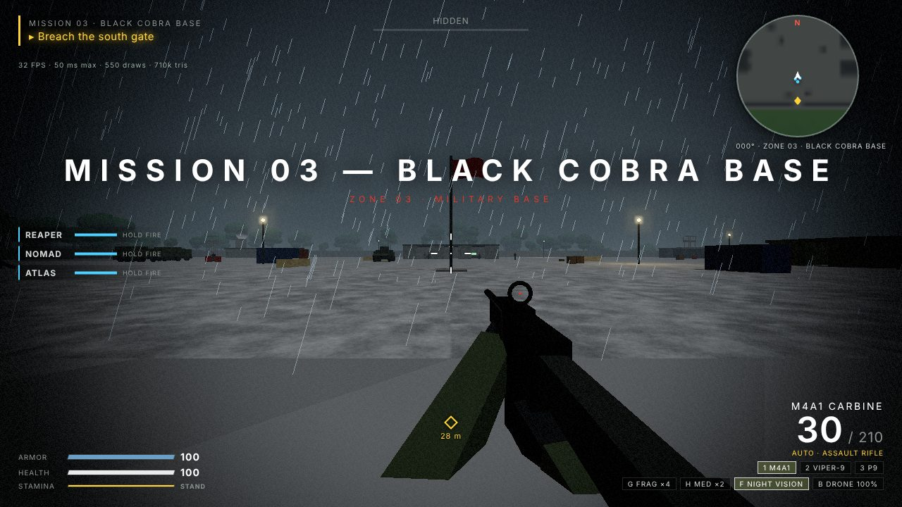 군사기지(뇌우) |
| 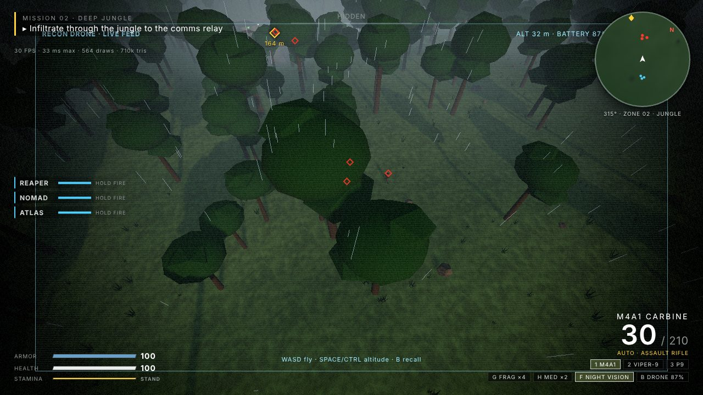 정찰 드론 | 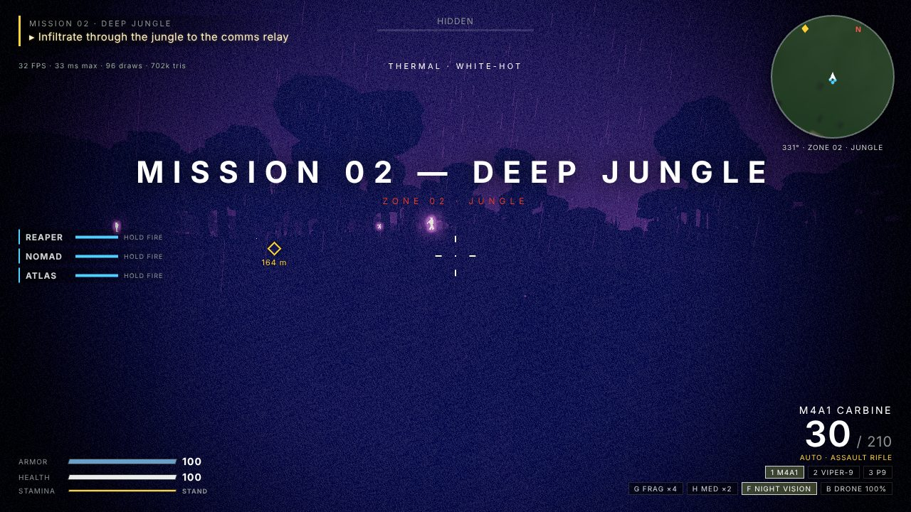 열화상 |
| 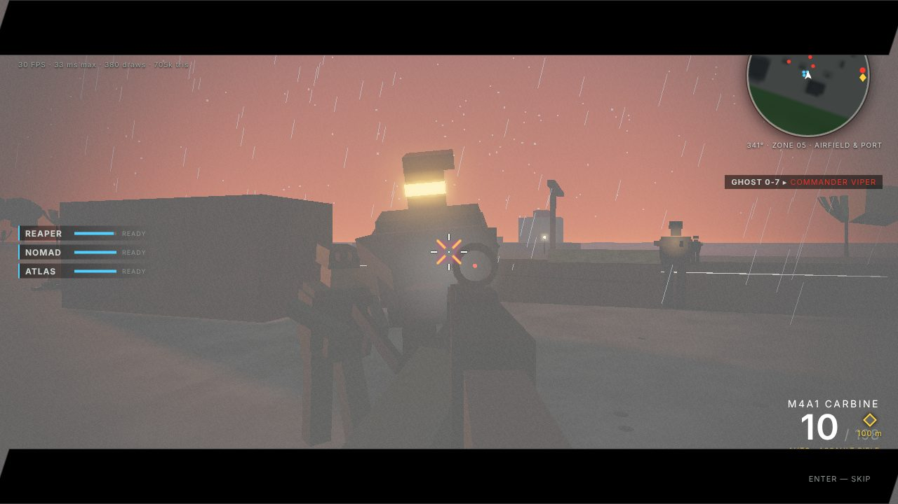 보스전 | 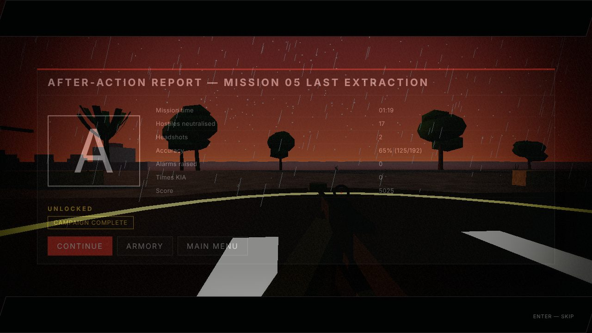 결과 화면 |
- **v0.5 빌드**(실내 소품 9종·대전차 장애물·크레인·화물선을 Blender 모델로 교체): 캠페인 구간 **16 / 16 통과** (1,592 s), 미션 01–05 완주, 콘솔 에러 0건, JS 힙 117 MB. 성능(SwiftShader): Low 1.6 · Medium 1.0 · High 1.4 FPS, 드로콜 415, 삼각형 232만.
- **v0.6 빌드**(병사 전투복·장구류·총기 디테일 강화, 다색 위장무늬, 구조물 8종 교체): 캠페인 구간 **16 / 16 통과** (1,436 s), 미션 01–05 완주, 콘솔 에러 0건, JS 힙 125 MB. 성능(SwiftShader): Low 1.3 · Medium 1.0 · High 1.3 FPS, 드로콜 413, 삼각형 246만(v0.5 대비 +14만 — 병사 1인당 폴리곤 증가분). 실제 GPU 성능은 여전히 미검증입니다.
- **v0.7 빌드**(적 병사 종류별 키트·위장 패턴, 거리 LOD): 캠페인 구간 **16 / 16 통과** (1,391 s), 미션 01–05 완주, 콘솔 에러 0건, JS 힙 133 MB. 성능(SwiftShader): Low 1.5 · Medium 0.5 · High 1.5 FPS. 삼각형 246만 → 233만으로 줄었지만 드로콜은 413 → 513으로 늘었습니다(디테일 노드가 별도 메시라 근거리 병사가 많으면 증가). 실제 GPU에서 어느 쪽이 이득인지는 미검증입니다.
- **v0.7.1 빌드**(병사 노드당 메시 1개 + LOD 교체): 캠페인 구간 **16 / 16 통과** (1,461 s), 콘솔 에러 0건. 드로콜 513 → 356 (v0.6의 413보다 낮음), 삼각형 237만. 성능(SwiftShader): Low 1.9 · Medium 0.5 · High 1.1 FPS.
- **v0.8 빌드**(Poly Haven CC0 사진 텍스처: 지형 스플랫 + 박스 재질): 캠페인 구간 **16 / 16 통과** (1,673 s), 미션 01–05 완주, 콘솔 에러 0건, JS 힙 141 MB. 드로콜 351, 삼각형 237만. 성능(SwiftShader): Low 1.4 · Medium 0.4 · High 0.7 FPS — 지형 셰이더가 텍스처를 8번 읽어 소프트웨어 렌더러에서는 v0.7.1보다 느립니다. 실제 GPU 영향은 미검증입니다.
- **v0.9 빌드**(Blender 모델에 사진 텍스처: 소품 표면 분류, 병사 직물, 총기·차량·나무껍질): 캠페인 구간 **16 / 16 통과** (1,732 s), 미션 01–05 완주, 콘솔 에러 0건, JS 힙 150 MB. 드로콜 353, 삼각형 237만. 성능(SwiftShader): Low 1.1 · Medium 0.7 · High 1.1 FPS. 실제 GPU 성능은 미검증입니다.
